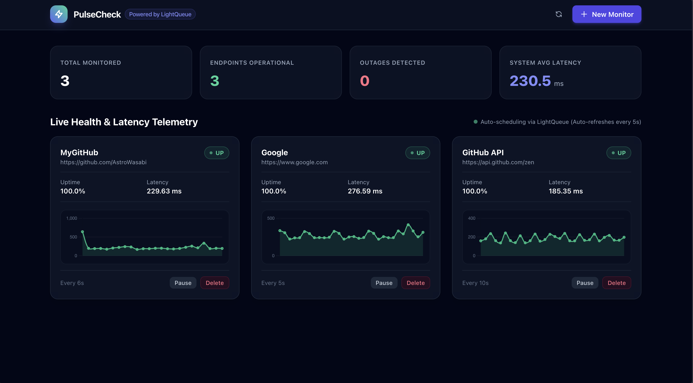

# PulseCheck

PulseCheck is an API and website uptime monitoring service built on FastAPI and LightQueue. It runs background health checks on target URLs, measures network latency, records check history in an asynchronous SQLite database, and presents live telemetry on a dark-mode web dashboard.



## Overview

Most small monitoring tools use a central loop that sleeps for N seconds, queries every endpoint, and runs checks sequentially. When a system monitors dozens of endpoints with different intervals, that approach introduces drift and blocks on slow responses.

PulseCheck delegates execution to LightQueue. Each monitor operates on its own schedule through a self-rescheduling task loop. The check task measures latency, saves the result to SQLite, and schedules its own next run through LightQueue's delayed execution queue. Pausing a monitor stops the cycle; resuming enqueues an immediate check to start it again.

## Architecture

```
[ User Browser ]
       |
       v (HTTP GET / POST)
[ FastAPI Web App ] <------------+
       |                         |
       | enqueues check          | reads metrics
       v                         v
 [ LightQueue ]           [ aiosqlite DB ]
       |                  (pulsecheck.db)
       | executes task           ^
       v                         |
 [ Worker: check_endpoint ] -----+
       | - Runs HTTP GET via httpx
       | - Records status and latency
       | - Dispatches alert on failure
       | - Self-reschedules via countdown
```

### Key components

- `pulsecheck/db.py`: Database operations using `aiosqlite`. Manages `monitors` and `check_results` tables with automatic cascading deletes and queries for 24-hour uptime percentages and average latencies.
- `pulsecheck/tasks.py`: Background tasks registered with LightQueue.
  - `check_endpoint`: Measures roundtrip latency using `httpx.AsyncClient`, updates database records, detects state transitions, and enqueues the next check using `countdown=interval_seconds`.
  - `send_alert`: Runs asynchronously when an endpoint fails, logging incident details without blocking the monitoring worker.
- `pulsecheck/web.py`: FastAPI routes providing the HTML dashboard, form actions for adding and managing monitors, and JSON endpoints for Chart.js telemetry charts.
- `pulsecheck/templates/dashboard.html`: Server-rendered dashboard styled with Tailwind CSS. Includes status cards, latency sparklines powered by Chart.js, and a 5-second polling loop that updates telemetry without page reloads.

## Database schema

PulseCheck uses two tables in SQLite:

```sql
CREATE TABLE monitors (
    id INTEGER PRIMARY KEY AUTOINCREMENT,
    name TEXT NOT NULL,
    url TEXT NOT NULL,
    interval_seconds INTEGER DEFAULT 30,
    timeout_seconds REAL DEFAULT 5.0,
    is_active BOOLEAN DEFAULT 1,
    status TEXT DEFAULT 'pending',
    created_at REAL NOT NULL
);

CREATE TABLE check_results (
    id INTEGER PRIMARY KEY AUTOINCREMENT,
    monitor_id INTEGER NOT NULL,
    timestamp REAL NOT NULL,
    status_code INTEGER DEFAULT 0,
    latency_ms REAL DEFAULT 0.0,
    is_up BOOLEAN NOT NULL,
    error_message TEXT,
    FOREIGN KEY (monitor_id) REFERENCES monitors(id) ON DELETE CASCADE
);
```

## Setup and usage

### Prerequisites

- Python 3.11 or newer
- LightQueue installed (from the local package directory)

### Installation

```bash
git clone https://github.com/your-username/pulsecheck.git
cd pulsecheck
python3 -m venv .venv
source .venv/bin/activate

# Install dependencies
pip install aiosqlite fastapi jinja2 uvicorn httpx pytest pytest-asyncio

# Install the LightQueue dependency
pip install -e ../lightqueue
```

### Running the application

Start the web dashboard and background worker:

```bash
python run.py
```

The launcher starts two components in the same process:
1. The LightQueue worker coordinator running with a concurrency limit of 4.
2. The Uvicorn web server listening on `http://127.0.0.1:8000`.

Open your browser to `http://localhost:8000` to access the dashboard.

### Adding monitors

1. Click "New Monitor" in the top navigation bar.
2. Enter a friendly name, target URL, check interval (5 to 3600 seconds), and timeout threshold.
3. Submit the form. The first ping fires immediately, and the card starts rendering live latency charts within seconds.

## Running tests

Run the test suite:

```bash
python -m pytest -v
```

The tests cover:
- SQLite table initialization, CRUD operations, and uptime calculations (`tests/test_db.py`).
- HTTP ping execution, failure handling, alert triggering, and self-rescheduling into LightQueue's priority heap (`tests/test_tasks.py`).
- Web route handling, form submission redirects, JSON history endpoints, and HTML template rendering (`tests/test_web.py`).
